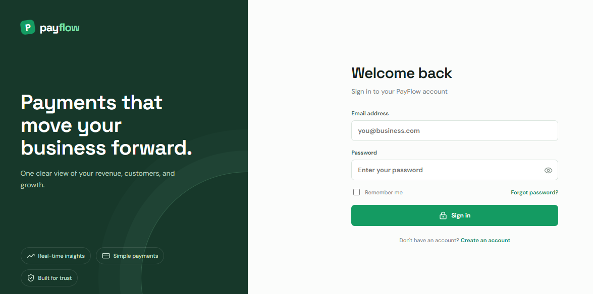
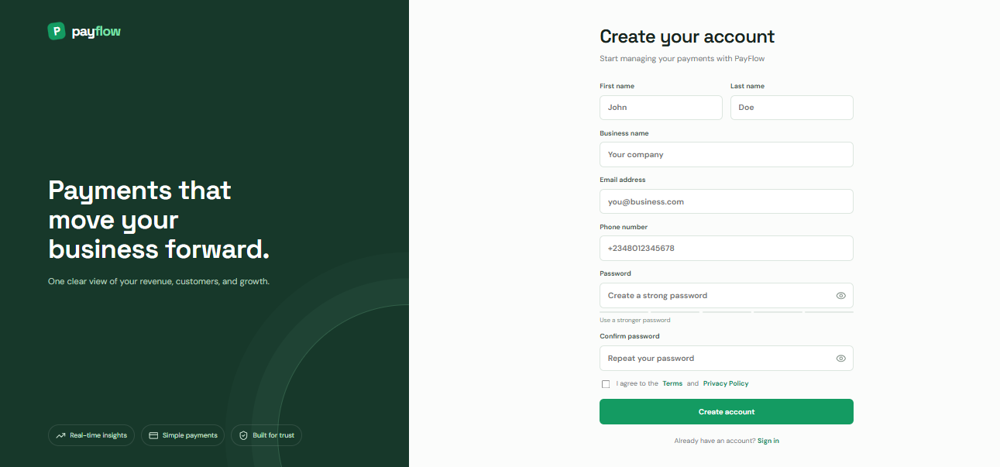
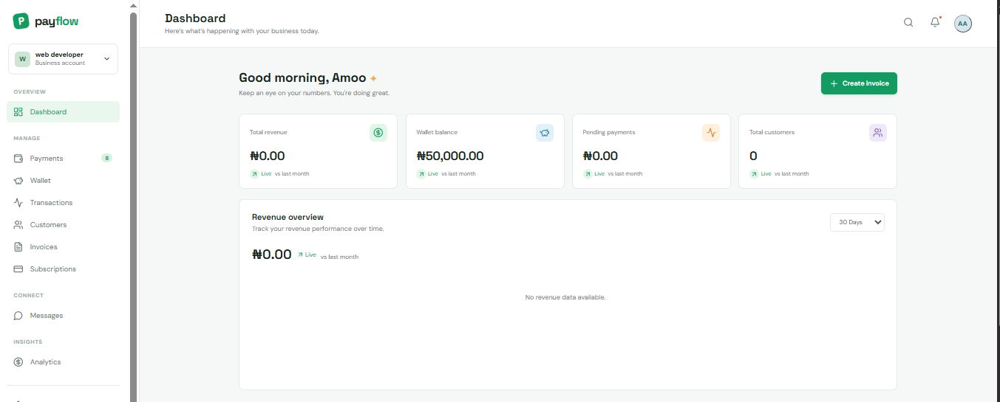

# PayFlow

PayFlow gives businesses a single place to review payment activity and manage day-to-day financial operations. Its dashboard brings revenue, wallet balance, pending payments, and customer totals into view, while dedicated areas cover payments, transactions, customers, invoices, subscriptions, analytics, and messaging. The project is aimed at businesses that need clearer payment oversight and customer operations—not just a generic finance dashboard.

The repository contains a React frontend and a Go API. Backend features require the API, MongoDB, Redis, and any relevant external-service configuration to be running; the presence of a screen in the frontend does not by itself mean it is connected to a live service.

## Features

- **Authentication:** Login and business registration interfaces, with backend signup, login, refresh, logout, and account-recovery routes. The API issues JWTs and protects authenticated routes.
- **Dashboard and revenue visibility:** Summary, revenue, transaction, and customer data routes power the dashboard and analytics views.
- **Payments:** Payment initialization and verification are implemented through Paystack. The backend also exposes payment listing, summary, detail, and webhook routes.
- **Business operations:** Backend routes support customer records, invoices, subscriptions, wallet balance, transfers, and read-only transaction history.
- **Analytics:** Summary, revenue, transaction, customer, and payment analytics routes are available.
- **Messaging:** The backend supports conversations and messages over authenticated HTTP routes and a WebSocket connection.
- **Supporting account features:** Profile and business settings, notifications, email verification, password reset, and optional phone verification routes are present.
- **Nigerian naira display:** Frontend currency formatting uses NGN (`₦`).

The frontend includes the corresponding application areas, but functionality depends on the configured API and services. The screenshots are interface captures: their displayed figures are not proof of actual funds or live transactions. A development-only seed command is also included for dashboard data.

## Application Screenshots

### Login Page



The sign-in screen provides email and password fields, a remember-me option, password recovery, and a link to create an account.

### Registration Page



The registration screen collects personal and business details, email, phone number, and password confirmation to create a business account.

### Business Dashboard



The dashboard screenshot shows a financial overview with total revenue, wallet balance, pending payments, customer metrics, and a revenue overview. Its navigation links to payments, wallet, transactions, customers, invoices, subscriptions, messages, and analytics. The figures shown—including the NGN wallet amount—are captured interface content and should not be treated as live balances.

## Technology Stack

| Area | Technologies |
| --- | --- |
| Frontend | React 19, Vite, Tailwind CSS, React Router |
| Backend | Go 1.23, Gin |
| Data and cache | MongoDB, Redis |
| Authentication | JWT access and refresh tokens |
| Payment provider | Paystack |
| Frontend package manager | npm |
| Backend containerization | Docker and Docker Compose |

## Project Structure

```text
.
├── assets/
│   └── screenshots/          # Login, registration, and dashboard captures
├── backend/
│   ├── cmd/
│   │   ├── server/            # API server entry point
│   │   └── seed/              # Development data seeding command
│   ├── internal/
│   │   ├── config/            # Environment-backed configuration
│   │   ├── database/          # MongoDB, Redis, and seed setup
│   │   ├── handlers/          # HTTP and WebSocket handlers
│   │   ├── middleware/        # Authentication and CORS
│   │   ├── models/            # Domain models
│   │   ├── realtime/          # WebSocket hub
│   │   ├── repositories/      # Persistence operations
│   │   ├── routes/             # API route registration
│   │   └── services/           # Business logic and integrations
│   ├── .env.example            # Backend environment variable template
│   ├── docker-compose.yml      # API, MongoDB, and Redis services
│   ├── Dockerfile
│   ├── go.mod
│   └── README.md               # Additional backend notes
└── frontend/
    ├── src/
    │   ├── components/         # Shared interface components
    │   ├── context/            # Application/authentication context
    │   ├── pages/              # Authentication and product screens
    │   ├── routes/             # Public and protected route guards
    │   ├── services/           # API and WebSocket clients
    │   └── utils/              # Shared utilities, including currency formatting
    ├── .env.production.example # Frontend API URL example
    ├── package.json
    └── vite.config.js
```

## Prerequisites

- Git
- Node.js and npm compatible with the Vite version in `frontend/package.json`
- Go 1.23
- Docker with the Docker Compose plugin, or existing MongoDB and Redis services

## Installation and Setup

### 1. Get the repository

```sh
git clone https://github.com/0xAlpha01/PayFlow.git
cd PayFlow
```

### 2. Configure and start the backend

```sh
cd backend
cp .env.example .env
```

Edit `backend/.env` and set unique values for `JWT_ACCESS_SECRET` and `JWT_REFRESH_SECRET`. The backend requires both secrets. The example file provides local MongoDB and Redis connection defaults; update them if your services use different addresses or credentials.

Start MongoDB and Redis using the included Compose configuration:

```sh
docker compose up -d mongodb redis
```

Install Go module dependencies and run the API:

```sh
go mod download
go run ./cmd/server
```

The API listens on port `8080` by default. Its health checks are available at `/` and `/healthz`.

To run the development data seeder, set `APP_ENV=development` and `SEED_USER_ID` to a valid MongoDB ObjectID in the backend environment, then run:

```sh
go run ./cmd/seed
```

The seed command refuses to run unless `APP_ENV` is `development`.

### 3. Configure and run the frontend

In another terminal, from the repository root:

```sh
cd frontend
npm ci
npm run dev
```

Vite's development server is normally available at `http://localhost:5173`. The frontend API client defaults to `http://localhost:8080/api/v1`. To use another API address, set `VITE_API_URL`; [frontend/.env.production.example](frontend/.env.production.example) documents the frontend variable for a production build. Set it to the API origin and `/api/v1` path for the environment you are configuring.

### Build, lint, and test

Run frontend commands from `frontend/`:

```sh
npm run build
npm run lint
```

Run backend commands from `backend/`:

```sh
go test ./...
go build -o payflow ./cmd/server
```

The backend also includes a Dockerfile for building a container image:

```sh
docker build -t payflow-api .
```

Provide the runtime environment variables and network access to MongoDB and Redis when running that image.

## Environment Variables

Backend configuration is read from the process environment and, when present, `backend/.env`. Use [backend/.env.example](backend/.env.example) as the template. Do not copy real credentials into source control.

| Variable | Purpose |
| --- | --- |
| `PORT` | Backend listen port; defaults to `8080`. |
| `MONGODB_URI` | MongoDB connection URI; defaults to `mongodb://localhost:27017`. |
| `MONGODB_DATABASE` | MongoDB database name; defaults to `payflow`. |
| `REDIS_ADDR` | Redis host and port; defaults to `localhost:6379`. |
| `REDIS_PASSWORD` | Redis password; blank for the local default. |
| `REDIS_DB` | Redis database number; defaults to `0`. |
| `JWT_ACCESS_SECRET` | Required signing secret for access tokens. |
| `JWT_REFRESH_SECRET` | Required signing secret for refresh tokens; use a different secret from the access-token secret. |
| `ACCESS_TOKEN_EXPIRY` | Access-token lifetime; defaults to `15m`. |
| `REFRESH_TOKEN_EXPIRY` | Refresh-token lifetime; defaults to `168h`. |
| `CLIENT_URL` | Allowed frontend origin(s) for CORS; defaults to `http://localhost:5173`. The configuration supports comma-separated origins. |
| `APP_ENV` | Environment mode; the seed command requires `development`. |
| `SEED_USER_ID` | MongoDB ObjectID used by the development seed command. |
| `SMTP_HOST`, `SMTP_PORT`, `SMTP_USERNAME`, `SMTP_PASSWORD`, `SMTP_FROM` | SMTP settings for email-related flows. The port defaults to `587`; `SMTP_FROM` defaults to `SMTP_USERNAME`. |
| `SMS_PROVIDER`, `SMS_API_KEY`, `SMS_SENDER_ID` | SMS provider settings for phone-verification flows. |
| `PAYSTACK_SECRET_KEY`, `PAYSTACK_PUBLIC_KEY` | Paystack credentials for payment integration. Keep secret keys on the backend only. |
| `PAYSTACK_BASE_URL` | Paystack API base URL; defaults to `https://api.paystack.co`. |

The frontend accepts `VITE_API_URL` to select the API base URL. If unset, the source defaults to the local API at `http://localhost:8080/api/v1`. Vite variables are included in frontend builds; do not put private credentials in `VITE_*` variables.

## API Overview

Application API routes use the `/api/v1` prefix. Unless stated otherwise, the following route groups require JWT authentication.

| Area | Routes and capabilities |
| --- | --- |
| Health | `GET /` and `GET /healthz` |
| Authentication | `POST /auth/signup`, `/auth/login`, `/auth/refresh`, `/auth/forgot-password`, `/auth/reset-password`, `/auth/verify-email`, and `/auth/resend-email-verification` are public. Authenticated routes include `POST /auth/logout`, `GET /auth/me`, and phone-code send/resend/verify actions. |
| Dashboard | `GET /dashboard/summary`, `/dashboard/revenue`, `/dashboard/transactions`, `/dashboard/customers` |
| Analytics | `GET /analytics/summary`, `/analytics/revenue`, `/analytics/transactions`, `/analytics/customers`, `/analytics/payments` |
| Customers | List, create, retrieve, update, and delete customers; retrieve a customer's payments or transactions under `/customers`. |
| Payments | Authenticated initialize, verify, summary, list, and detail routes under `/payments`; `POST /payments/webhook` is registered separately from JWT middleware. |
| Invoices | List, create, retrieve, update, delete, send, and mark paid under `/invoices`. |
| Subscriptions | List, create, retrieve, update, cancel, and summary under `/subscriptions`. |
| Transactions | Read-only list and detail routes under `/transactions`. The backend documents transactions as a projection of verified payments. |
| Wallet and transfers | `GET /wallet/balance`; authenticated create/list operations under `/transfers`. |
| Messaging | User search, conversations, messages, read state, and unread count under `/chat`; WebSocket connection at `GET /ws`. |
| Settings and notifications | Profile, business, notification preferences, and password settings under `/settings`; notification list, unread count, and read actions under `/notifications`. |

See `backend/internal/routes/routes.go` for the complete route registration and authentication boundaries.

## Security and Limitations

- Use strong, unique JWT secrets and keep backend secrets in environment configuration, not in frontend code or committed files.
- The frontend requires a reachable backend for server-backed features. Email, SMS, and Paystack flows also depend on valid provider configuration.
- The dashboard screenshot is a visual example. Its financial figures are not a statement of actual balances or processed payments; the frontend formats amounts in Nigerian naira (NGN).
- A backend route or frontend screen does not guarantee that a deployment has working credentials, configured external services, or production operational controls. Review and configure those pieces before handling real business data or payments.

## Contributing

Contributions are welcome. Open an issue to discuss a substantial change, then submit a focused pull request with a clear description. Run the relevant frontend lint/build commands and backend tests before submitting. Do not include credentials or real customer/payment data in changes or reports.

## License

No license file is present in this repository, so the project does not specify license terms for reuse, modification, or redistribution.
